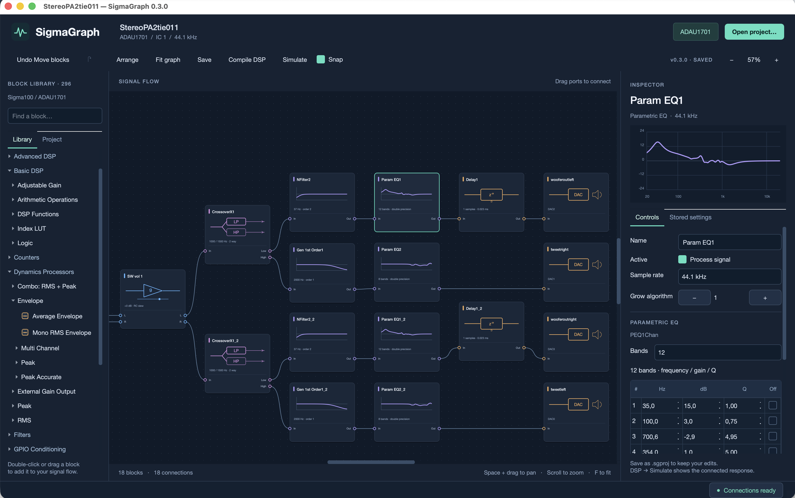

# SigmaGraph



[](https://github.com/katealhola/sigmagraph/actions/workflows/build.yml)
[](LICENSE)

A native SigmaDSP graph editor for **macOS and Linux**, with an independent
**ADAU1701 compiler**, frequency-response simulation and native USBi tools.
It runs without Wine or a running SigmaStudio installation.

- Import `.dspproj` graphs and edit nodes, wires, settings and layout.
- Add blocks from a 288-type toolbox, with function drawings inside nodes.
- Save and reopen native `.sgproj` projects, with undo/redo.
- Compile supported blocks into program/parameter RAM images and C arrays.
- Plot magnitude/phase response and export CSV.
- Use command-line USBi/ICP3 tools for backup, RAM testing and live safeload.

The compiler supports a subset of the editing toolbox. `.dspproj` is an import
format; native `.sgproj` saves cannot be opened by SigmaStudio. See
[the editor and compiler guide](docs/user-guide.md) for supported algorithms and
simulation limits.

## Run from source

Requires Python 3.10 or newer and a graphical desktop.

```sh
git clone https://github.com/katealhola/sigmagraph.git
cd sigmagraph
python3 -m venv .venv
source .venv/bin/activate
python -m pip install -e .
sigmagraph examples/stereo-crossover.sgproj
```

Compile without opening the GUI:

```sh
python -m sigmagraph.compiler examples/stereo-crossover.sgproj -o local/crossover-build
```

Linux needs desktop/OpenGL libraries; for Debian/Ubuntu, see
[build instructions](docs/building.md). USB access additionally requires native
libusb and appropriate device permissions. No USB connection is needed to edit,
compile, simulate, or run the automated tests.

## Download builds

Open a successful run under [Actions → Build](https://github.com/katealhola/sigmagraph/actions/workflows/build.yml)
and download the matching artifact. Each contains a versioned application archive
and SHA-256 checksum.

| Artifact | Native build runner | Result |
|---|---|---|
| `SigmaGraph-macos-x86_64` | `macos-15-intel` | Intel Mac `.app` in ZIP |
| `SigmaGraph-macos-arm64` | `macos-15` | Apple Silicon `.app` in ZIP |
| `SigmaGraph-linux-x86_64` | `ubuntu-24.04` | Application directory in `.tar.gz` |
| `SigmaGraph-linux-arm64` | `ubuntu-24.04-arm` | Application directory in `.tar.gz` |
| `SigmaGraph-source` | `ubuntu-24.04` | Python wheel and source distribution |

macOS builds require macOS 14 or later and are ad-hoc signed, without Apple
notarization. Linux builds target Ubuntu 24.04 or a compatible system with the
same or newer glibc. They are native builds; there is no cross-compilation or
emulation. CI tests both the source and the frozen GUI before uploading artifacts.

## Repository layout

```text
sigmagraph/                Desktop app, graph model, compiler and simulation
  data/                   Toolbox metadata and presets
examples/                 Generated native project examples
tests/                   Portable model, compiler, parser and GUI checks
scripts/                  CI test, archive and dependency-license helpers
tools/usbi/               Native libusb transport, ICP3 loader and recovery tests
tools/reverse_engineering/ NRBF, assembly and optional managed-IL research tools
docs/                     User guide, build guide and protocol findings
.github/workflows/        Native build matrix and source packages
LICENSE                   GPLv3 text; project uses GPL-3.0-or-later
```

## Development

```sh
python -m pip install -e '.[build]'
python scripts/run_tests.py
python scripts/build_app.py --output dist
python scripts/package_release.py
```

See [CONTRIBUTING.md](CONTRIBUTING.md) for optional reference-corpus tests and
[docs/building.md](docs/building.md) for CI details.

## Hardware status

One WONDOM ICP3 and ADAU1701 preamp were tested on native macOS: complete RAM
read/write verification, DSP arithmetic, live safeload and three instrumented
compiled-graph DC cases passed. Original RAM was restored and verified. Analog
I/O, filter frequency response, delay timing, other programmers and Linux USB
operation remain unverified. The editor has no USB programming UI yet.
[Hardware findings](docs/hardware.md) and [USBi commands](tools/usbi/README.md)
state the tested scope. No target EEPROM programmer is implemented.

## License

Copyright (C) 2026 Kate Alhola and contributors.

SigmaGraph is free software under the **GNU General Public License, version 3
or (at your option) any later version**. See [LICENSE](LICENSE) and
[third-party notices](THIRD_PARTY_NOTICES.md).
